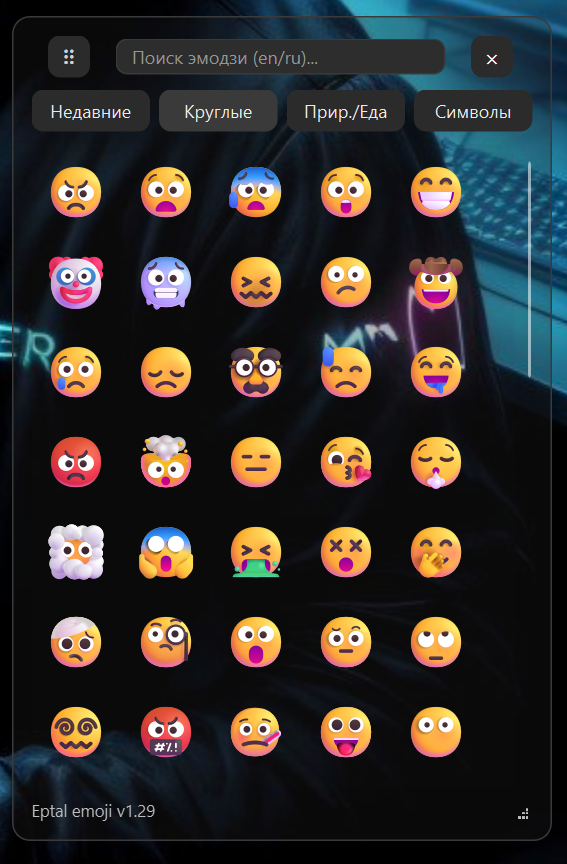
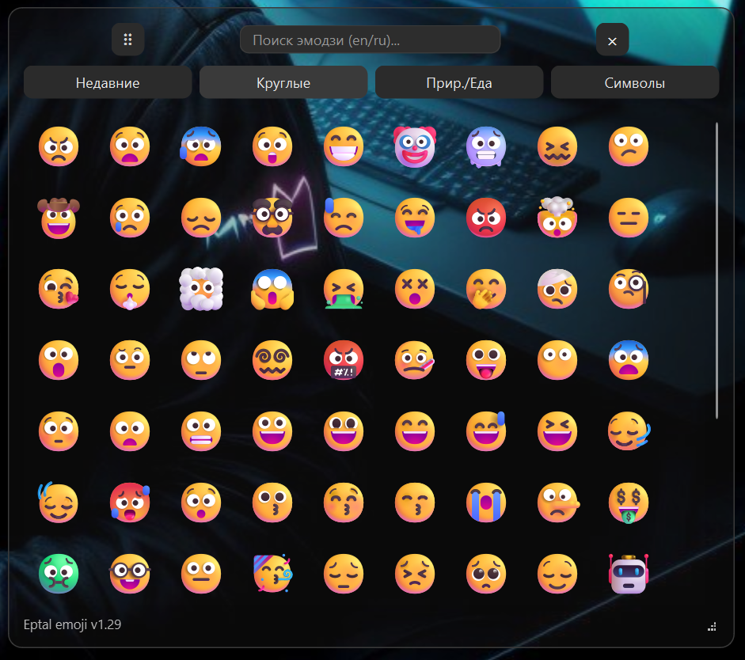
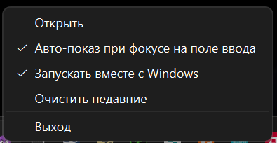

# Eptal Emoji

[Русский](README.md) | **English**

**Eptal Emoji** is a lightweight and convenient emoji picker for Windows with a clean, semi-transparent interface. It is designed to make adding emojis quick, natural, and effortless — anywhere you work with text. I use Eptal Emoji every day myself, so the app is shaped around simplicity, convenience, and real-world use.

## Why It's Convenient

- **Works in any chat or text field** — you can insert emojis even where there is no built-in emoji panel or emoji support.
- **Almost no setup required** — install it, launch it, and start using it right away.
- **Quick access** — open it with the `Ctrl+Alt+E` hotkey or from the system tray.
- **Unobtrusive interface** — a compact semi-transparent window with a muted dark background stays out of your way and looks clean over other windows.
- **Your own emojis inside the app** — you can add custom emojis, organize them, and keep your favorites close at hand.

## Features

- **One-click insertion** — clicking an emoji copies it to the clipboard and tries to paste it into the active input field.
- **Hotkey** — `Ctrl+Alt+E` for quick access.
- **Auto-show** — the window can appear automatically when a text field gets focus (can be toggled from the tray menu).
- **Tray integration** — a system tray icon lets you show/hide the window with a double-click and access settings from the tray menu.
- **Search and categories** — convenient name search (en/ru) and categories: Recent, Round, Nature/Food, Symbols, Added.
- **Recent emojis** — your recently used emojis are saved for quick reuse.
- **Custom emojis** — add your own emojis directly in the app using the `+` button.
- **Emoji management** — move emojis between categories by dragging, and remove unwanted ones from the context menu.
- **Comfortable window** — borderless interface, drag to move, resize support, saved position and settings.
- **Autostart** — optionally launch with Windows.

## Screenshots

Semi-transparent window; you can resize it to your preference.





App settings are available by right-clicking the Eptal emoji icon in the system tray.



## Requirements

- Windows
- Python 3.10+ (for running from source)

Dependencies:
- PyQt6
- emoji
- keyboard
- pyperclip
- uiautomation

## Install and Run from Source

```bash
pip install -r requirements.txt
pythonw eptal_emoji.py
```

## Build a Standalone `.exe` (PyInstaller)

```bash
pip install pyinstaller
pyinstaller --noconfirm --clean --onefile --windowed --icon=eptal_emoji.ico --name EptalEmoji eptal_emoji.py
```

The output file will appear in `dist/EptalEmoji.exe`. You can use `Start.bat` to launch it.

## Usage

- `Ctrl+Alt+E` — show the emoji picker window.
- Click an emoji — insert it into the active field (when possible).
- `+` button — add your own emojis.
- Drag an emoji onto a tab — move it between categories.
- Right-click an emoji — delete/hide it.
- Double-click the tray icon — show/hide the window.

## Notes

- Auto-show on focus and auto-paste depend on the target application and UI Automation availability.
- Global hotkeys/hooks (`keyboard`) may require running with elevated privileges in some cases.
- History, settings, added and hidden emojis are stored locally in the user profile.

## License

This project is distributed under the MIT License. See [LICENSE](LICENSE).
