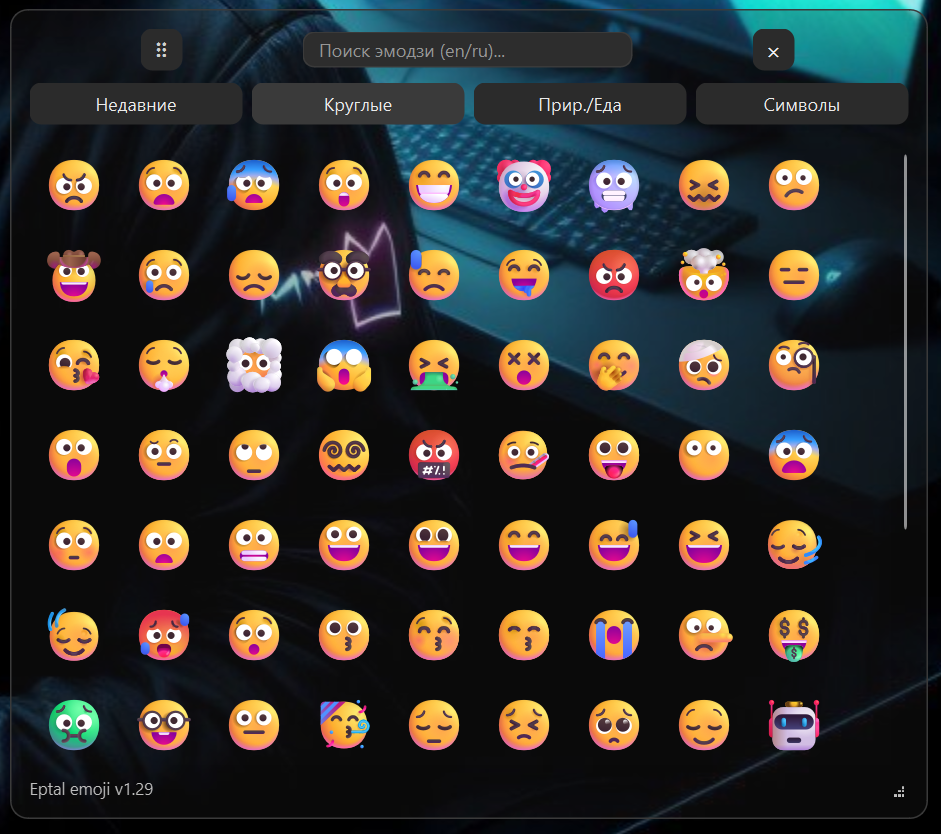
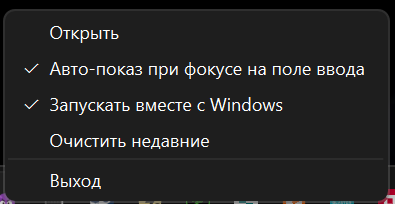

# Eptal Emoji

**Eptal Emoji** — лёгкий и удобный пикер эмодзи для Windows с аккуратным полупрозрачным интерфейсом. Приложение создано для того, чтобы добавлять эмодзи быстро, естественно и без лишних действий — в любом месте, где вы работаете с текстом. Я сам пользуюсь Eptal Emoji каждый день, поэтому приложение развивается вокруг простоты, удобства и реальных сценариев использования.

## Почему это удобно

- **Работает в любом чате и поле ввода** — эмодзи можно вставлять даже там, где нет встроенной панели смайликов или поддержки эмодзи.
- **Практически не требует настройки** — установили, запустили и сразу пользуетесь.
- **Быстрый доступ** — вызывается горячей клавишей `Ctrl+Alt+E` или из системного трея.
- **Ненавязчивый интерфейс** — компактное полупрозрачное окно с тёмным приглушённым фоном не мешает работе и аккуратно смотрится поверх других окон.
- **Свои эмодзи прямо в программе** — можно добавлять собственные смайлики, упорядочивать их и держать под рукой всё самое нужное.

## Возможности

- **Вставка в одно нажатие** — клик по эмодзи копирует его в буфер обмена и пытается вставить в активное поле ввода.
- **Горячая клавиша** — `Ctrl+Alt+E` для быстрого открытия окна.
- **Авто-показ** — при фокусе на текстовом поле окно может появляться автоматически (функция включается/выключается в меню трея).
- **Работа из трея** — значок в области уведомлений: двойной клик открывает/скрывает окно, а меню трея даёт быстрый доступ к настройкам.
- **Поиск и категории** — удобный поиск по названию (en/ru) и категории: «Недавние», «Круглые», «Прир./Еда», «Символы», «Добавл.».
- **Недавние эмодзи** — выбранные смайлики сохраняются в истории для быстрого повторного использования.
- **Свои эмодзи** — добавляйте собственные эмодзи прямо в приложение через кнопку `+`.
- **Управление смайликами** — переносите эмодзи между категориями перетаскиванием и удаляйте ненужные через контекстное меню.
- **Удобное окно** — безрамочный интерфейс, перетаскивание за заголовок, изменение размера, сохранение позиции и настроек.
- **Автозапуск** — при желании можно включить запуск вместе с Windows.

## Скриншоты

Полупрозрачное окно; размер можно изменять по своему вкусу.




Настройки приложения доступны по правому клику на значок Eptal emoji в области уведомлений (трее).



## Требования

- Windows
- Python 3.10+ (для запуска из исходников)

Зависимости:
- PyQt6
- emoji
- keyboard
- pyperclip
- uiautomation

## Установка и запуск из исходников

```bash
pip install -r requirements.txt
pythonw eptal_emoji.py
```

## Сборка автономного `.exe` (PyInstaller)

```bash
pip install pyinstaller
pyinstaller --noconfirm --clean --onefile --windowed --icon=eptal_emoji.ico --name EptalEmoji eptal_emoji.py
```

Готовый файл появится в `dist/EptalEmoji.exe`. Для запуска можно использовать `Start.bat`.

## Использование

- `Ctrl+Alt+E` — показать окно выбора эмодзи.
- Клик по эмодзи — вставка в активное поле (если возможно).
- Кнопка `+` — добавить свои эмодзи.
- Перетаскивание эмодзи на вкладку — перенос между категориями.
- Правый клик по эмодзи — удалить/скрыть смайлик.
- Двойной клик по значку в трее — открыть/скрыть окно.

## Примечания

- Авто-показ по фокусу и авто-вставка зависят от целевого приложения и доступности UI Automation.
- Глобальные горячие клавиши/хуки (`keyboard`) в некоторых случаях могут требовать запуска с повышенными правами.
- История, настройки, добавленные и скрытые эмодзи сохраняются локально в профиле пользователя.

## Лицензия

Проект распространяется по лицензии MIT. См. файл [LICENSE](LICENSE).
