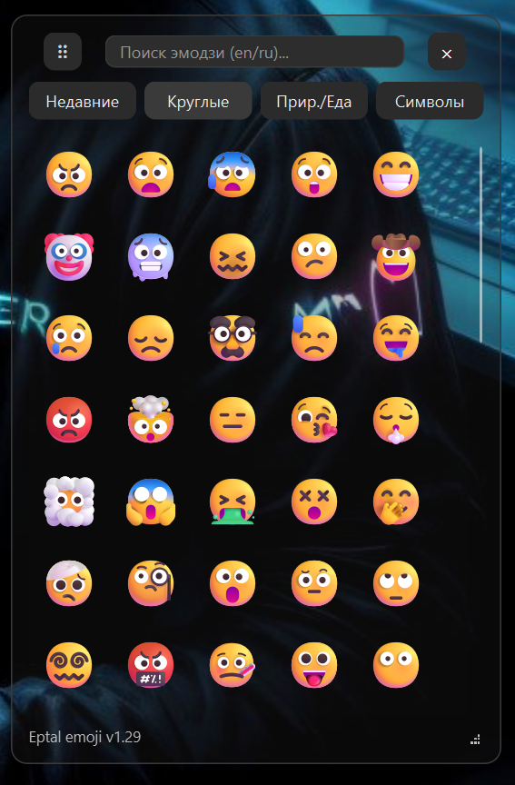

# Eptal emoji

Лёгкий пикер эмодзи для Windows с полупрозрачным безрамочным интерфейсом. Написан на **Python 3** с использованием **PyQt6**.

## Возможности

- **Быстрый выбор эмодзи** — клик по эмодзи копирует его в буфер обмена и пытается вставить в активное поле ввода.
- **Горячая клавиша** — `Ctrl+Alt+E`.
- **Авто-показ** — при фокусе на текстовом поле (через UI Automation) окно может появляться автоматически (включается/выключается в меню трея).
- **Работа в трее** — значок в области уведомлений; двойной клик по значку открывает/скрывает окно.
- **Меню трея** — открыть окно, авто-показ при фокусе, автозапуск вместе с Windows, очистка «Недавних», выход.
- **Позиционирование** — окно появляется в правом нижнем углу активного монитора; при повторном открытии на том же экране позиция сохраняется.
- **Интерфейс** — тёмная полупрозрачная тема, безрамочное окно, перетаскивание, изменение размера (размер запоминается).
- **Категории** — «Недавние», «Круглые», «Прир./Еда», «Символы».
- **Поиск** — поиск по эмодзи/названиям.
- **Недавние** — эмодзи в порядке последних нажатий (локальная история).
- **Автозапуск** — опционально, для текущего пользователя Windows.

## Скриншоты

Полупрозрачное окно; размер можно изменять по своему вкусу.




## Требования

- Windows
- Python 3.10+ (для запуска из исходников)

Зависимости:
- PyQt6
- emoji
- keyboard
- pyperclip
- uiautomation

## Установка и запуск из исходников

```bash
pip install -r requirements.txt
pythonw eptal_emoji.py
```

## Сборка автономного `.exe` (PyInstaller)

```bash
pip install pyinstaller
pyinstaller --noconfirm --clean --onefile --windowed --name EptalEmoji eptal_emoji.py
```

Готовый файл появится в `dist/EptalEmoji.exe`. Для запуска можно использовать `Start.bat`.

## Использование

- `Ctrl+Alt+E` — показать окно выбора эмодзи.
- Клик по эмодзи — вставка в активное поле (если возможно).
- Двойной клик по значку в трее — открыть/скрыть окно.
- Окно можно перетаскивать и менять его размер.

## Примечания

- Авто-показ по фокусу и авто-вставка зависят от целевого приложения и доступности UI Automation.
- Глобальные горячие клавиши/хуки (`keyboard`) в некоторых случаях могут требовать запуска с повышенными правами.
- История и настройки сохраняются локально в профиле пользователя.

## Лицензия

Проект распространяется по лицензии MIT. См. файл [LICENSE](LICENSE).
